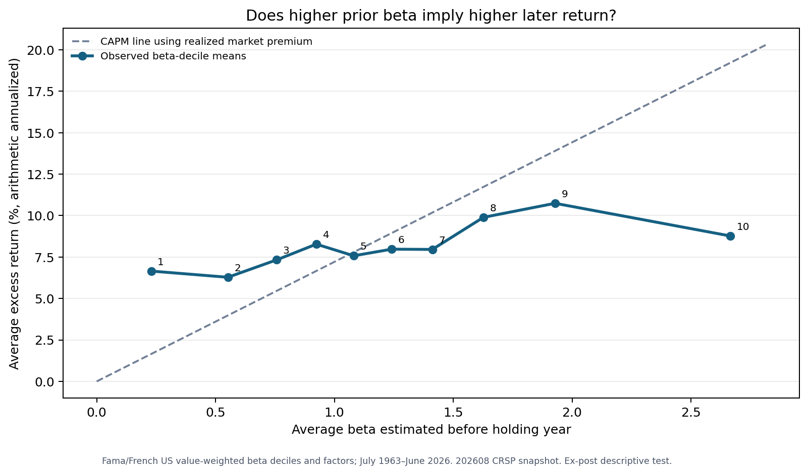
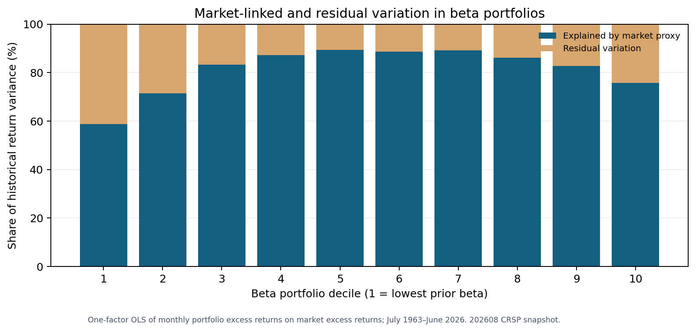

# CAPM in the real world: Does a higher beta actually earn more?

**The short answer:** In this U.S. sample, higher prior beta did not translate into a proportional increase in later average returns. Beta still helps describe how a portfolio moves with the market. It is much less reliable as a stand-alone return forecast.

I started this project because I wanted to make an Investment Analysis lecture easier to understand with actual numbers. The CAPM lecture moves from the capital market line to the security market line, then to beta, alpha, risk decomposition and empirical tests. What do those ideas look like outside a classroom diagram?

The model starts with investors choosing portfolios to balance expected return and volatility. If they share the same forecasts and can borrow or lend at the same risk-free rate, they choose the same optimal mix of risky assets. In aggregate, that mix becomes the market portfolio. This is a useful theoretical chain, but we cannot observe every investor's forecasts or every component of their wealth in these data.

## The idea in one equation

CAPM says an asset's **expected** excess return equals its market beta multiplied by the **expected** market risk premium:

**E(Rᵢ) − Rf = βᵢ × [E(Rm) − Rf]**

Beta measures exposure to market movements. A beta above 1 means more sensitivity to the market than the market has to itself; it does not mean the asset will earn a high return in every year. The security market line (SML) plots expected return against beta. The capital market line (CML) is different: it describes efficient portfolios using *total volatility* on its horizontal axis.

The lecture's economic argument is that investors can diversify away security-specific risk. Under CAPM's assumptions, only market-wide risk commands a premium. A market regression splits observed risk into a market-linked component and a residual component. That regression's R² is the share of observed return variance explained by the chosen market proxy; it is not the share of future returns that is predictable. CAPM says security-specific risk should not earn an extra premium; it does not say that risk disappears from an individual asset.

## A real-data check

I used the [Kenneth R. French Data Library's beta-sorted U.S. portfolios](https://mba.tuck.dartmouth.edu/pages/faculty/Ken.French/data_library.html) and its [monthly market and Treasury-bill factors](https://mba.tuck.dartmouth.edu/pages/faculty/Ken.French/data_library.html). The portfolio file assigns stocks to ten groups at the end of each June using **past** beta estimates. I then looked at the following July–June returns. The test covers 63 complete holding years, July 1963–June 2026, or 756 monthly returns per group. Returns are value-weighted and include dividends. The snapshot uses data available through August 2026; I retrieved it on 17 October 2026.

Across those holding years:

- The lowest-beta group had an average prior beta of **0.23** and an average excess return of **6.65% a year**.
- The highest-beta group had an average prior beta of **2.67** and an average excess return of **8.77% a year**.
- The *second-highest* beta group earned **10.74% a year** on average, more than the highest-beta group.
- The average realized market excess return was **7.21% a year**. Multiplying that historical premium by each group's average prior beta gives an *ex-post CAPM reference line*: about **1.66%** for the lowest group and **19.22%** for the highest. Those are retrospective comparison values, **not forecasts**.

For the CML intuition, the same market proxy had an average monthly excess return of **0.60%** and monthly standard deviation of **4.46%**. Its historical annualized Sharpe ratio was about **0.47**. That describes this proxy over this period; it does not establish that the unobserved complete market portfolio was efficient.

All annual figures above are 12 times the arithmetic mean monthly percentage return; they are not compounded annual growth rates. The observed highest-minus-lowest gap was **2.12 percentage points a year**. When I resampled whole July–June years, its illustrative 95% interval ranged from **−4.81 to +8.59 percentage points a year**. The positive average gap by itself is therefore not a precise estimate of a stable premium.

*Source: Eugene F. Fama and Kenneth R. French, [Data Library](https://mba.tuck.dartmouth.edu/pages/faculty/Ken.French/data_library.html), “Portfolios Formed on Market Beta” and “Fama/French 3 Research Factors”; 202608 CRSP database snapshot, retrieved 17 October 2026. Value-weighted U.S. portfolio returns; complete July 1963–June 2026 holding years. The dashed line uses the realized market premium and is an ex-post illustration.*

## What the regression adds

When I regressed each group's monthly excess return on the market's monthly excess return over the same sample, the lowest group's market beta was **0.59** and its R² was **0.59**. The highest group's regression beta was **1.60** and its R² was **0.76**. These values differ from the average *prior sorting betas* of 0.23 and 2.67 because the methods and time windows differ. This is why I show both measures and keep beta estimation separate from the later return test.

*Source: Fama/French Data Library, “Portfolios Formed on Market Beta” and “Fama/French 3 Research Factors”; 202608 CRSP snapshot, retrieved 17 October 2026. Bars are R² and 1 − R² from one-factor monthly regressions, July 1963–June 2026. They describe past variance using a U.S. stock-market proxy.*

The regression intercept is often called alpha. It measures average return left after accounting for the chosen market factor in this historical regression. It should not be called “skill” or “mispricing” without further evidence. Other risks, changing beta, data choices and luck can all contribute.

## Why CAPM remains useful — and where this test stops

Analysts use CAPM as a transparent starting point for the cost of equity, project valuation and fund-performance comparison. A financial model still needs a *forward-looking* risk-free rate and market premium, a beta consistent with the business and leverage, and sensitivity analysis. Historical realized market returns are not a ready-made forecast.

This test does **not** observe the complete theoretical market portfolio. The U.S. stock-market proxy leaves out human capital, private businesses and other wealth. The chart's regression residual may therefore include other shared risks, not just company-specific noise. CAPM also assumes shared expectations, unrestricted borrowing and short selling, and no taxes or trading costs. [Roll's critique](https://www.anderson.ucla.edu/documents/areas/fac/finance/1977-2.pdf) explains why a test using an incomplete market proxy cannot settle the theory. [Fama and French's 1992 paper](https://doi.org/10.1111/j.1540-6261.1992.tb04398.x) likewise reports a weak beta–average-return relationship in their historical U.S. stock sample.

**My conclusion:** Beta is a useful description of market exposure and a disciplined input for valuation. It is not, on its own, a promise that a higher-beta stock will earn more. The next practical question is whether a chosen cost-of-equity estimate remains reasonable when the market premium, beta window and business assumptions change.

## Reproduce the work

The Python project parses the original source ZIPs, checks units and dates, keeps June beta formation before subsequent returns, compares ten beta groups, adds a size-conditioned check and writes the chart. Its outputs should be updated when the source library publishes new data; each new snapshot must be dated so revisions are visible. The original copyrighted source files are linked above and are not republished in the repository.

**Project repository:** [Code, derived results and charts](https://github.com/jaehyuksong98-collab/finance-theory-in-practice/tree/main/capm_topic3). The [three-page methods PDF](https://github.com/jaehyuksong98-collab/finance-theory-in-practice/blob/main/capm_topic3/CAPM_Topic3_Methods.pdf) documents the formulas, sample and checks.

**Course reference:** *Investment Analysis, Topic 3 CAPM*, pp. 4–20 (private lecture note, not redistributed).

