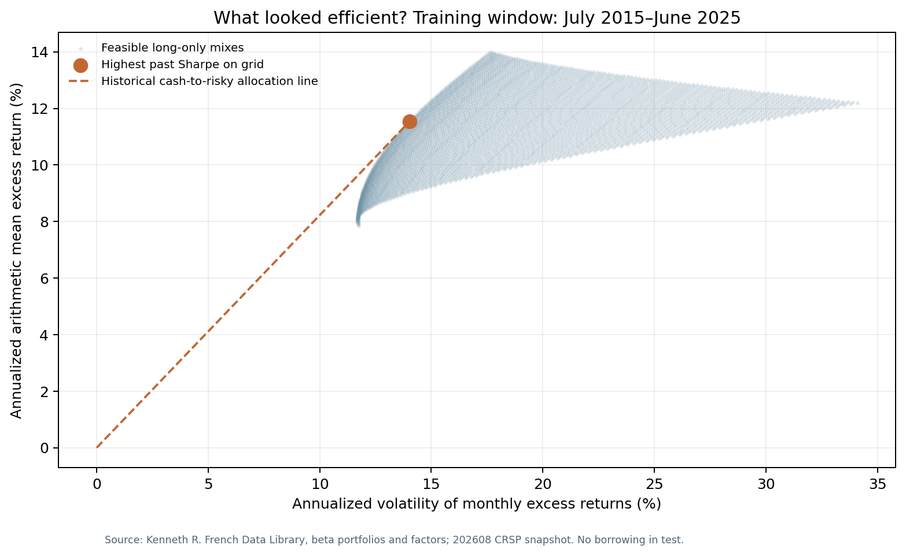
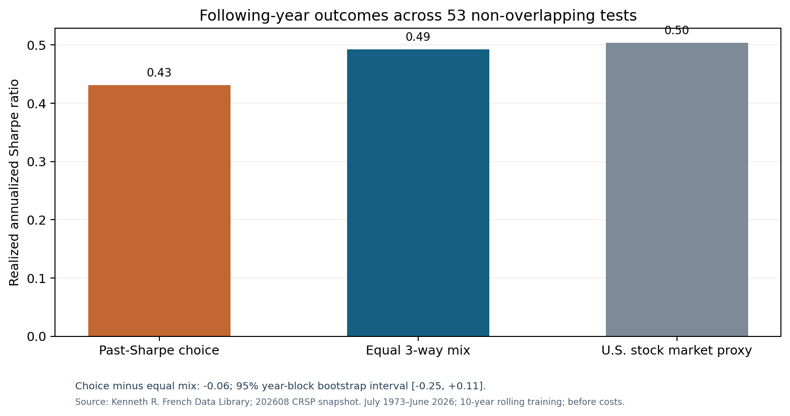

# When an “optimal” portfolio meets the next year

**A CAPM classroom diagram gives us a useful question: if we choose the best-looking mix using past data, will it still look best a year later?**

In this historical exercise, the answer was **not consistently**. A mix selected from the preceding 10 years had a realized annualized Sharpe ratio of **0.43** over July 1973–June 2026. Simply splitting the money equally across the same three portfolio groups produced **0.49**. Yet the uncertainty interval for the 0.06 difference includes zero. Changing the estimation window also changes which method looks better. These results are a reason to check a model outside the period used to build it, not a verdict that optimization never works.

## Why I started this test

Our Investment Analysis lecture shows an efficient frontier and a line from a risk-free asset toward an optimal risky portfolio. The picture makes sense: combine assets, measure their expected return and risk, then choose a mix that fits your preference. I wanted to see what happens when the “expected” return and risk must be **estimated from actual historical numbers**.

The textbook capital market line (CML) uses the complete market portfolio under strong equilibrium assumptions. The chart here is a smaller, estimated version: the feasible mixes of three U.S. equity portfolio groups. It helps explain the idea, but it is **not the true CML** and cannot directly prove or disprove CAPM.

## From the diagram to a decision

I used the [Kenneth R. French Data Library](https://mba.tuck.dartmouth.edu/pages/faculty/Ken.French/data_library.html), choosing its low-beta decile, middle-beta decile and high-beta decile. These are groups of stocks, not three individual companies. Their monthly value-weighted returns and the monthly Treasury-bill proxy are reported as percentages.

At each June decision point, my Python program looks only at the **previous 10 years** of monthly returns. It checks 5,151 possible mixes on a 1% weight grid, with no short selling or borrowing. It chooses the mix with the highest *past* Sharpe ratio, then records what happens over the **following July–June year**. The comparison is an equal mix of the same three groups. I repeat the exercise for 53 non-overlapping outcome years, from July 1973 through June 2026. The source snapshot is the library's **August 2026 CRSP release**, downloaded 17 October 2026.

Sharpe ratio means average excess return divided by return volatility. “Excess” here means above the monthly risk-free proxy. The figures below annualize the **arithmetic monthly average** and monthly standard deviation; they are not compound annual growth rates.

*Chart 1. Three U.S. value-weighted beta-decile groups, training window July 2015–June 2025. Each dot is a feasible long-only mix. The line from zero to the chosen orange point is a historical cash-to-risky allocation illustration. Source: [Kenneth R. French Data Library](https://mba.tuck.dartmouth.edu/pages/faculty/Ken.French/data_library.html), 202608 CRSP snapshot, downloaded 17 October 2026. Calculated 27 October 2026. It is not the complete-market CML or a forward forecast.*

The final decision in that series, made using July 2015–June 2025 observations, selected **40% low-beta, 60% middle-beta and 0% high-beta** for July 2025–June 2026. The observed returns in that following year were never used to choose those weights.

## What happened later?

Across all **636 subsequent test months**, the past-Sharpe choice earned **5.67%** average annualized excess return with **13.16%** annualized volatility. The equal mix earned **8.54%** with **17.35%** volatility. So the selected mix took less risk and earned less on average. The risk-adjusted comparison is the more relevant one: Sharpe ratios of **0.431** and **0.492**, respectively. The [U.S. stock-market proxy](https://mba.tuck.dartmouth.edu/pages/faculty/Ken.French/ftp/F-F_Research_Data_Factors_CSV.zip) had a realized Sharpe of **0.504** over the same months.

*Chart 2. Pooled realized annualized Sharpe ratios, July 1973–June 2026; gross, before costs. The selected-minus-equal difference is −0.062. A paired July–June year-block bootstrap gives a descriptive 95% interval from −0.246 to +0.114, so the data do not establish a clear risk-adjusted advantage for either choice. Source: [Kenneth R. French Data Library](https://mba.tuck.dartmouth.edu/pages/faculty/Ken.French/data_library.html), 202608 CRSP snapshot, downloaded 17 October 2026; calculations 27 October 2026.*

The conclusion changes with one reasonable modelling choice. On the **same July 1978–June 2026 outcome window**, a 5-year estimation history gives the selected mix a Sharpe of **0.490**, a 10-year history **0.504**, and a 15-year history **0.605**. The equal mix is **0.527** on that common window. The 15-year choice comes out ahead there; the 5- and 10-year choices do not. The 0.431 shown above for 10 years includes five earlier outcome years, so its start date differs from the common-window comparison.

## What I take from it

“Optimal” should always have a label: *optimal using which data, which assets, which objective, and which constraints?* Historical estimates move when the sample changes. A line that looks efficient in the training chart need not deliver the highest later Sharpe. It can also be perfectly reasonable for a chosen lower-risk mix to have a lower average return.

This is a **historical backtest**, not a trade recommendation or a direct CAPM test. The complete market portfolio and investors' expectations are not observable in these files. The three portfolio groups are not directly investable funds. This is an exploratory follow-up to an earlier CAPM analysis, so the asset groups were not selected blind to all historical returns. Costs, turnover, taxes, borrowing constraints and later revisions to the data can matter. The year-block interval is descriptive; overlapping training windows and dependence between years limit its formal interpretation. We have not identified why one lookback did better, and selecting a lookback after seeing these results would introduce another layer of hindsight.

I wrote the [reproducible Python analysis and methods notes](https://github.com/jaehyuksong98-collab/finance-theory-in-practice/tree/main/capm_topic3/cml_followup) so future releases can be compared with the same decision rules. The code keeps each June training window separate from its following year, records every chosen weight, and includes a raw-data spot check. The next useful step is to retain each new data snapshot, flag historical revisions, and see whether the interpretation survives them.

**Sources:** [Fama/French beta portfolios](https://mba.tuck.dartmouth.edu/pages/faculty/Ken.French/ftp/Portfolios_Formed_on_BETA_CSV.zip); [Fama/French factors](https://mba.tuck.dartmouth.edu/pages/faculty/Ken.French/ftp/F-F_Research_Data_Factors_CSV.zip); [Data Library definitions and revision notes](https://mba.tuck.dartmouth.edu/pages/faculty/Ken.French/data_library.html); [Sharpe (1964), “Capital Asset Prices”](https://doi.org/10.1111/j.1540-6261.1964.tb02865.x). Source vintage: 202608 CRSP database; downloaded 17 October 2026.
