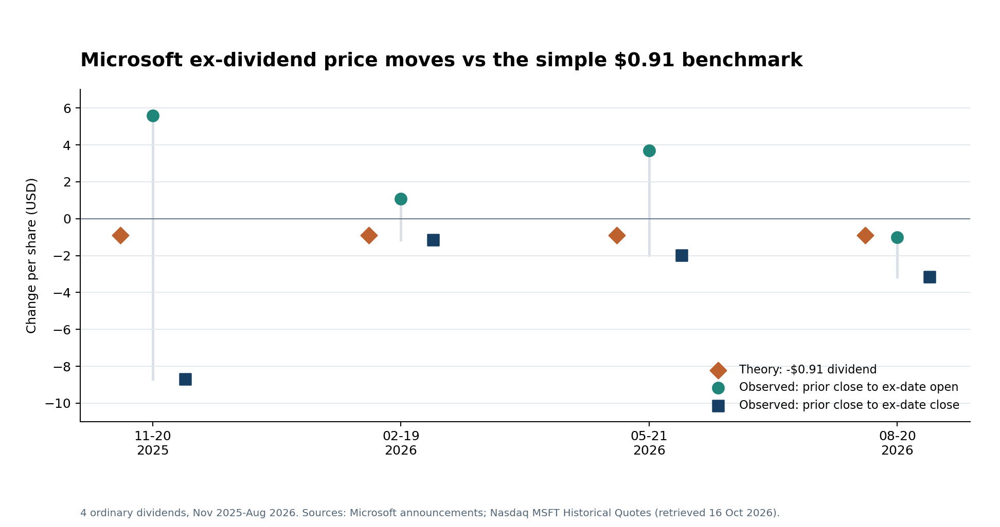

# Does a stock really fall by the dividend on its ex-dividend date?

**Conclusion first:** The dividend adjustment is a useful theoretical benchmark, not a reliable prediction of an individual day's observed price. In a four-event Microsoft pilot, the share opened below the previous close only once. It closed lower on all four ex-dividend dates, but every closing move differed from the $0.91 dividend.

In Corporate Finance, I learned why the *ex-dividend date* matters: a buyer on that date no longer receives the declared cash dividend. Holding all else equal, a $0.91 payment removes about $0.91 of value per share from the company and transfers it to the shareholder. Nasdaq describes an ex-date price adjustment of roughly the dividend amount. “Roughly” and “all else equal” are doing important work here.

I wanted to test what I could actually see in market data. I matched four Microsoft ordinary dividends from November 2025 through August 2026 to the previous trading day's close and the ex-date open and close. The dividend was $0.91 per share each time. Microsoft supplied the official dates and amounts; Nasdaq supplied the displayed historical prices. I used the price fields rather than a dividend-adjusted close, which would hide part of the very movement I am trying to inspect.

The chart compares three dollar-per-share changes for each event: the simple theoretical benchmark of **-$0.91**, the observed move from the previous close to the ex-date open, and the move from the previous close to the ex-date close.

*Sources: Microsoft dividend announcements dated 15 September 2025, 2 December 2025, 10 March 2026, and 10 June 2026; Nasdaq MSFT Historical Quotes, retrieved 16 October 2026. Period: 20 November 2025 to 20 August 2026. All changes are USD per share.*

The clearest example of the limit is 20 November 2025. Microsoft closed at **$487.12** the day before the ex-date, then opened at **$492.71** and closed at **$478.43**. The opening move was **+$5.59**, while the closing move was **-$8.69**. Neither equals the **-$0.91** benchmark. The dividend yield at the prior close was only **0.19%**, so other price movements can easily dominate it.

Does that mean the finance theory is wrong? No. It means a one-day stock quote contains more than the dividend effect. Overnight information, the broader market and intraday trading also move the price. The opening price is closer in time to the ex-date adjustment; the closing price includes the entire trading session. With one company and four events, I cannot isolate a causal dividend effect or claim how the market behaves on average.

There is also an investor accounting point. A lower share price alone is not the whole return: a holder entitled to the dividend has both the ex-date share value and a $0.91 cash claim. My code therefore calculates a simple dividend-inclusive close-to-close return as `(ex-date close + dividend - previous close) / previous close`. It does not imply that this is a tradable profit after taxes, transaction costs or price risk.

I built a small Python project to keep extending this test. It records event dates, source URLs and prices; checks input consistency; calculates the benchmark, observed gaps and dividend-inclusive returns; creates the comparison chart; and preserves dated snapshots when new events arrive. It flags changed historical rows for manual review. The next step is a pre-specified multi-company sample with market controls and corporate-action checks.

**Practical takeaway:** Use the dividend-sized drop as a valuation and total-return benchmark. Do not treat it as a guaranteed trading signal on a specific ex-dividend day.

**Project code:** [Finance Theory in Practice repository](https://github.com/jaehyuksong98-collab/finance-theory-in-practice/tree/main/ex_dividend_msft). **Methods PDF:** [two-page report](https://github.com/jaehyuksong98-collab/finance-theory-in-practice/blob/main/ex_dividend_msft/output/MSFT_Ex_Dividend_Methods_2026-10-16.pdf).

**Sources**

- [Nasdaq Global Indexes, *Total Return without the Dividend?* (August 2025), p. 1 / Chart 1](https://www.nasdaq.com/docs/total-return-without-the-dividend)
- [Microsoft, 15 September 2025 dividend announcement](https://news.microsoft.com/source/2025/09/15/microsoft-announces-quarterly-dividend-increase-6/)
- [Microsoft, 2 December 2025 dividend announcement](https://news.microsoft.com/source/2025/12/02/microsoft-announces-quarterly-dividend-27/)
- [Microsoft, 10 March 2026 dividend announcement](https://news.microsoft.com/source/2026/03/10/microsoft-announces-quarterly-dividend-28/)
- [Microsoft, 10 June 2026 dividend announcement](https://news.microsoft.com/source/2026/06/10/microsoft-announces-quarterly-dividend-29/)
- [Nasdaq, MSFT Historical Quotes](https://www.nasdaq.com/market-activity/stocks/msft/historical) (retrieved 16 October 2026)

## Separate feed introduction

I tested a familiar Corporate Finance idea against four Microsoft ex-dividend dates: does the stock fall by the cash dividend? The answer is more interesting than a yes or no. This article shows the prices, the calculation and the Python workflow I am building to check the theory over time.

